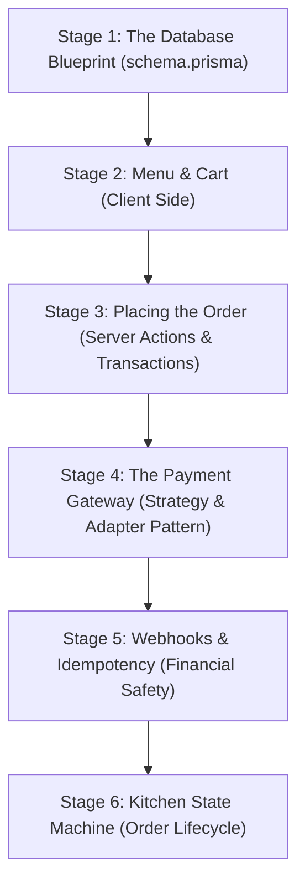

# 🗺️ Master Learning Roadmap: Understanding the F&B Payment Architecture

Welcome! If you are feeling overwhelmed by all the folders, design patterns, and server actions, **that is completely normal**. This project was built using senior-level engineering patterns (Strategy Pattern, State Machines, Idempotency, and Server-Side Financial Snapshotting).

This roadmap breaks down the entire codebase step-by-step into **easy, intuitive concepts** using real-world analogies.

---

## 🍽️ The Big Picture: The Restaurant Analogy

Before looking at any code, understand how every part of the application maps to a real restaurant:

```
[Customer at Table] ──(1. Reads Menu)────────► [Menu Catalog]
        │
        ├──(2. Puts food on tray)──────────► [Cart in Browser LocalStorage]
        │
        ├──(3. Hands order to Waiter)──────► [Server Action: createOrderAction]
        │                                           │
        │                                           ▼
[Cashier Counter]   ◄──(4. Generates Bill)──── [Database: Order & Transaction]
        │
        ├──(5. Customer Pays at EDC/QRIS)──► [Payment Gateway (Dummy or Xendit)]
        │                                           │
        │                                           ▼ (6. Payment Confirmed Webhook)
[Kitchen Display]   ◄──(7. Cook Prepares Food) [Order Status: PAID -> PREPARING]
```

| Restaurant Concept | Code Location | What It Does |
| :--- | :--- | :--- |
| **Printed Menu** | `src/features/menu/` | Food list, descriptions, and current prices. |
| **Customer's Tray** | `src/features/orders/hooks/use-cart.tsx` | Temporary client-side items kept while browsing. |
| **Order Slip** | `OrderItem` in `prisma/schema.prisma` | **Price frozen in time**. (If price changes tomorrow, old slips don't change). |
| **Cashier Terminal (EDC)** | `src/lib/payment/` | Pluggable payment processor (Dummy Simulator or real Xendit). |
| **Bank Confirmation SMS** | `/api/webhooks/payment` | The bank notifying our system that the customer actually paid. |
| **Kitchen Order Board** | `src/features/orders/components/order-board.tsx` | Kitchen staff moving orders: `PAID` ➔ `PREPARING` ➔ `COMPLETED`. |

---

## 🧭 Step-by-Step Learning Stages

Follow these 6 stages in order. Do not jump ahead until each concept clicks!



---

## 📌 Stage 1: The Database Blueprint
> **Goal:** Understand what tables exist and why they relate to each other.
>
> 📂 **Files to read:**
> - [prisma/schema.prisma](file:///e:/training/architecture-payment/prisma/schema.prisma)

### Key Concept: The 5 Core Tables
1. **`User`**: Who is ordering? Has a `role` (`CUSTOMER` or `ADMIN`).
2. **`MenuItem`**: What dishes exist right now? (`name`, `price`, `isAvailable`).
3. **`Order`**: A bill with a unique code like `ORD-20261124-ABCDEF` and a `status` (`PENDING_PAYMENT`, `PAID`, `PREPARING`, `COMPLETED`, `CANCELLED`).
4. **`OrderItem`**: The items inside an order.
   * 💡 **Crucial Best Practice: Snapshotting!**
   * Notice fields: `itemNameSnapshot` and `unitPrice`.
   * *Why?* If "Ayam Goreng" is Rp 25.000 today and the admin increases it to Rp 35.000 next week, previous receipts must still say Rp 25.000! Never link order totals directly to dynamic menu prices.
5. **`PaymentTransaction`**: Tracks payment attempts for an order.
   * One order can have multiple payment attempts (e.g. if the first payment link expires, the customer clicks "Retry Payment" to generate a second transaction).

---

## 📌 Stage 2: Browsing & The Cart
> **Goal:** Understand how customers view food and manage their cart without hydration bugs.
>
> 📂 **Files to read in order:**
> 1. [src/features/menu/queries/get-menus.ts](file:///e:/training/architecture-payment/src/features/menu/queries/get-menus.ts)
> 2. [src/app/(public)/page.tsx](file:///e:/training/architecture-payment/src/app/(public)/page.tsx)
> 3. [src/features/orders/hooks/use-cart.tsx](file:///e:/training/architecture-payment/src/features/orders/hooks/use-cart.tsx)
> 4. [src/features/orders/components/cart-drawer.tsx](file:///e:/training/architecture-payment/src/features/orders/components/cart-drawer.tsx)

### Key Concept: Safe Client State & Hydration
* **The Server Query**: `getMenus()` runs purely on the server (`import "server-only"`). It fetches available food and caches it using Next.js cache tags.
* **The Cart Hook (`use-cart.tsx`)**:
  * Cart state lives in the browser's `localStorage` (`fnb-cart-v1`).
  * 💡 **Why start with `EMPTY_CART`?**
    The server does not have access to the user's browser `localStorage`. If the client renders 2 items during hydration while the server rendered 0 items, React crashes with a **Hydration Mismatch**.
    To prevent this, `useCart` starts empty on initial render, and then loads `localStorage` inside `useEffect()` immediately after mount.

---

## 📌 Stage 3: Placing an Order (The Checkout Server Action)
> **Goal:** See what happens when the customer clicks "Checkout".
>
> 📂 **Files to read in order:**
> 1. [src/features/orders/schemas/order-schema.ts](file:///e:/training/architecture-payment/src/features/orders/schemas/order-schema.ts)
> 2. [src/features/orders/actions/create-order.ts](file:///e:/training/architecture-payment/src/features/orders/actions/create-order.ts)

### Key Concept: Never Trust Client Data!
When the client calls `createOrderAction`, look at what it does:
1. **Validates user input with Zod**: Checks structure and limits.
2. **Re-checks DB Prices**: It **ignores** whatever price the client thought it had. It queries `db.menuItem.findMany` with the IDs from the cart and sums up the real, active prices from the database.
3. **Database Transaction (`db.$transaction`)**:
   It creates both the `Order` and the initial `PaymentTransaction` atomically. If the database crashes midway, it rolls back so you never end up with an order that has no payment record.
4. **Asks Payment Provider for an Invoice**: It calls the payment provider to get a `checkoutUrl`.
5. **Returns clean response**: Sends the `checkoutUrl` back to the browser to redirect the user.

---

## 📌 Stage 4: The Pluggable Payment Gateway (The Adapter Pattern)
> **Goal:** Understand the cleanest architectural pattern in this project.
>
> 📂 **Files to read in order:**
> 1. [src/lib/payment/types.ts](file:///e:/training/architecture-payment/src/lib/payment/types.ts)
> 2. [src/lib/payment/factory.ts](file:///e:/training/architecture-payment/src/lib/payment/factory.ts)
> 3. [src/lib/payment/providers/dummy-provider.ts](file:///e:/training/architecture-payment/src/lib/payment/providers/dummy-provider.ts)
> 4. [src/lib/payment/providers/xendit-provider.ts](file:///e:/training/architecture-payment/src/lib/payment/providers/xendit-provider.ts)

### Key Concept: The "Universal Adapter" (Strategy Pattern)
Imagine buying a universal power adapter for travel. Whether you plug into a US socket or an EU socket, your phone charges the same way.

In this project, `PaymentGatewayProvider` is that universal adapter:
```ts
export interface PaymentGatewayProvider {
  readonly name: PaymentProviderName;
  createInvoice(input: CreateInvoiceInput): Promise<CreateInvoiceResult>;
  verifyAndParseWebhook(headers: Headers, rawBody: string): Promise<NormalizedWebhookPayload>;
}
```

* **The Factory (`factory.ts`)**: Checks `process.env.PAYMENT_PROVIDER`.
  * If `"dummy"`: instantiates `DummyPaymentProvider`.
  * If `"xendit"`: instantiates `XenditPaymentProvider`.
* **Zero business logic changes needed!** When you want to go live, you just fill in `PAYMENT_PROVIDER=xendit` and your API keys in `.env`. You don't have to touch a single line in `create-order.ts`!

---

## 📌 Stage 5: Webhooks, Idempotency & Financial Safety
> **Goal:** How does our system safely find out that a customer paid?
>
> 📂 **Files to read in order:**
> 1. [src/lib/payment/signature.ts](file:///e:/training/architecture-payment/src/lib/payment/signature.ts)
> 2. [src/app/api/webhooks/payment/route.ts](file:///e:/training/architecture-payment/src/app/api/webhooks/payment/route.ts)
> 3. [src/features/orders/services/apply-payment-webhook.ts](file:///e:/training/architecture-payment/src/features/orders/services/apply-payment-webhook.ts)
> 4. [src/features/payments/components/dummy-checkout-simulator.tsx](file:///e:/training/architecture-payment/src/features/payments/components/dummy-checkout-simulator.tsx)

### Three Golden Rules of Fintech:

#### 1. Always Verify Signatures (Don't Trust Fake Requests)
Anyone on the internet could send a fake POST request to `/api/webhooks/payment` claiming "Hey, Order 123 is paid!".
* The payment provider must sign the request with a secret token.
* [src/lib/payment/signature.ts](file:///e:/training/architecture-payment/src/lib/payment/signature.ts) uses `crypto.timingSafeEqual` to verify the HMAC token without opening up timing attack vulnerabilities.

#### 2. Always Verify Amounts
If an order was Rp 50.000, and the webhook says `PAID` with amount Rp 10.000, `apply-payment-webhook.ts` checks:
```ts
if (transaction.amount !== payload.amount) {
  return { amountMismatch: true, ... }; // REJECT!
}
```

#### 3. Idempotency (Handling Duplicate Webhooks)
Payment gateways retry sending webhooks if the internet hiccups. You might receive the exact same "PAID" webhook 3 times.
* How does this project handle it?
```ts
const claimed = await tx.paymentTransaction.updateMany({
  where: { id: transaction.id, status: { not: "PAID" } },
  data: { status: "PAID", ... }
});

if (claimed.count === 0) {
  // It was already marked as PAID! Ignore duplicate safely.
  return { duplicate: true, ... };
}
```

---

## 📌 Stage 6: The Kitchen & Order State Machine
> **Goal:** How staff updates order progress without breaking rules.
>
> 📂 **Files to read in order:**
> 1. [src/features/orders/order-state.ts](file:///e:/training/architecture-payment/src/features/orders/order-state.ts)
> 2. [src/features/orders/actions/update-order-status.ts](file:///e:/training/architecture-payment/src/features/orders/actions/update-order-status.ts)
> 3. [src/features/orders/components/order-board.tsx](file:///e:/training/architecture-payment/src/features/orders/components/order-board.tsx)
> 4. [src/app/(dashboard)/admin/orders/page.tsx](file:///e:/training/architecture-payment/src/app/(dashboard)/admin/orders/page.tsx)

### Key Concept: Finite State Machine (FSM)
In a real restaurant, you cannot cook an order that hasn't been paid, and you cannot cancel an order that the customer already finished eating.

[src/features/orders/order-state.ts](file:///e:/training/architecture-payment/src/features/orders/order-state.ts) strictly defines allowed transitions:
```
PENDING_PAYMENT ──► CANCELLED
      │
      ▼ (Webhook marks PAID)
    PAID ──────────► PREPARING ──► COMPLETED
      │
      └───► CANCELLED
```

If an admin tries to move an order from `COMPLETED` back to `PENDING_PAYMENT`, `canTransition(from, to)` returns `false` and blocks the database update.

---

## 🧪 Hands-On Practice Checklist

To truly master this code, try doing these 3 exercises:

- [ ] **Exercise 1: Trace a payment flow**
  1. Open `http://localhost:3000`.
  2. Sign in with `customer@fnb.local` (Password: `Customer12345`).
  3. Add items to cart and click **Checkout**.
  4. Notice the dummy hosted simulator at `/checkout/dummy/[externalId]`.
  5. Click **Pay now** and observe the webhook call in your terminal console.
  6. Go to `/orders` and see your order marked **PAID**.

- [ ] **Exercise 2: Try the Kitchen Admin Board**
  1. Sign in with `admin@fnb.local` (Password: `Admin12345`).
  2. Open `/admin/orders`.
  3. Click **Start preparing** ➔ order becomes `PREPARING`.
  4. Click **Mark completed** ➔ order becomes `COMPLETED`.

- [ ] **Exercise 3: Code Challenge (Add a feature)**
  * Add a `tableNumber` field (e.g. Table 1, Table 2) to `createOrderSchema` and save it in the database notes or a new column in `Order`!

---

## 💡 Quick Reference Guide to Key Files

```
src/
├── app/                      # NEXT.JS APP ROUTER (Routing & Page Shells)
│   ├── (public)/             # Public pages: Menu (/), Dummy Checkout
│   ├── (auth)/               # Login & Register pages
│   ├── (dashboard)/          # Authenticated: Customer Orders (/orders), Admin Kitchen (/admin/orders)
│   └── api/webhooks/payment/ # Webhook receiver endpoint from payment providers
│
├── features/                 # DOMAIN LOGIC (Feature-driven modules)
│   ├── auth/                 # Sign in, Sign up, Better-Auth integration
│   ├── menu/                 # Catalog queries, Admin menu CRUD actions
│   ├── orders/               # Cart hook, Create order action, Kitchen status board
│   └── payments/             # Dummy checkout simulator view & queries
│
└── lib/                      # INFRASTRUCTURE & SHARED UTILITIES
    ├── auth.ts               # Better-Auth server configuration & role checks
    ├── db.ts                 # Prisma SQLite client singleton
    └── payment/              # Payment Gateway Strategy: types, factory, dummy & xendit adapters
```
